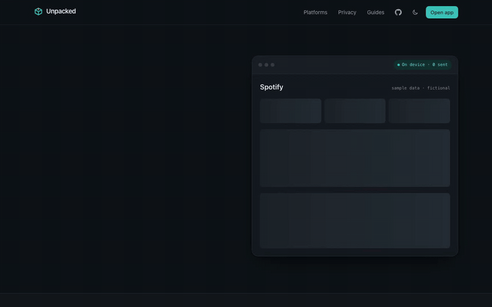
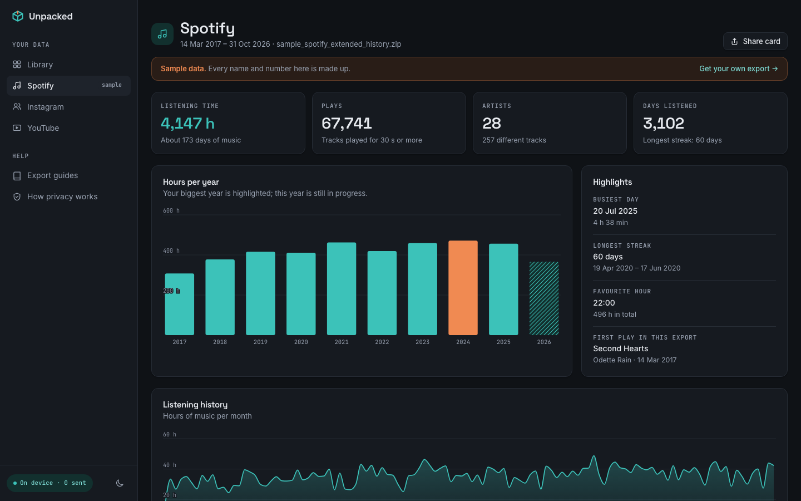
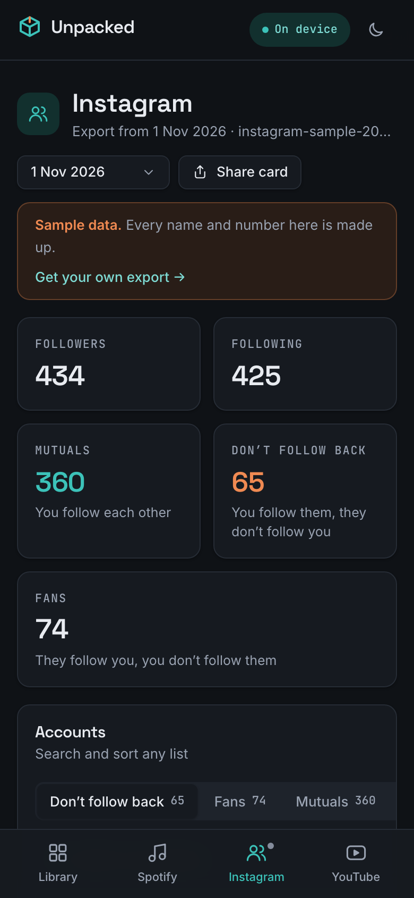
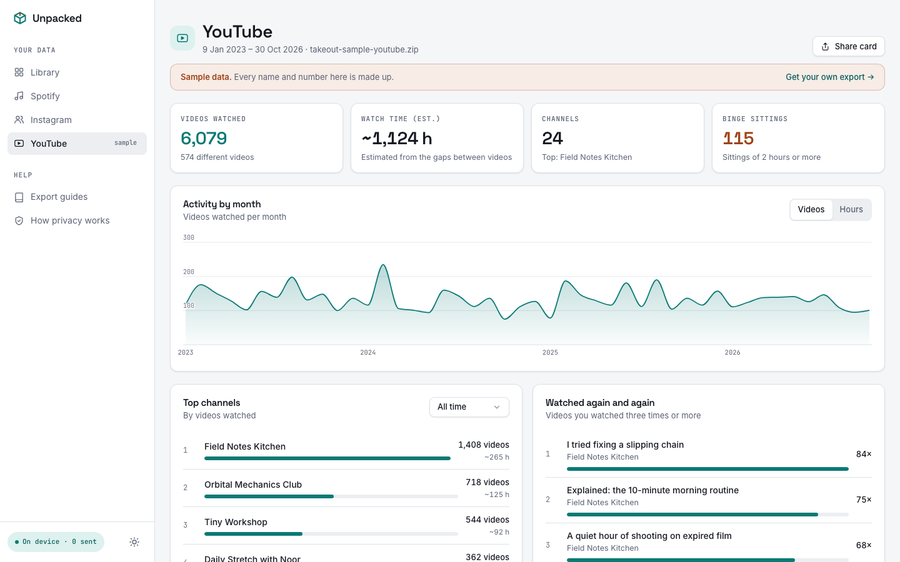
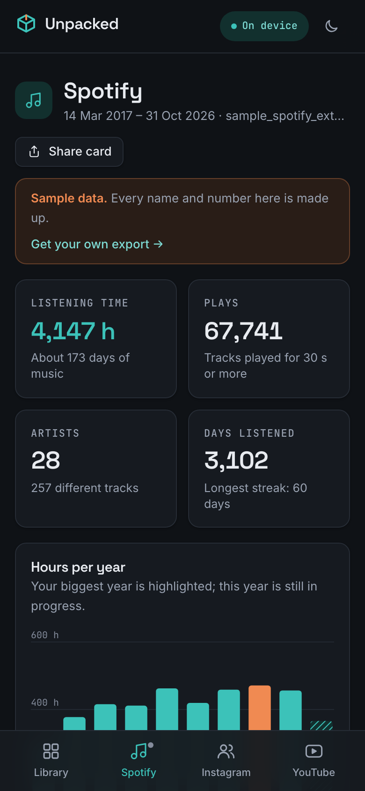
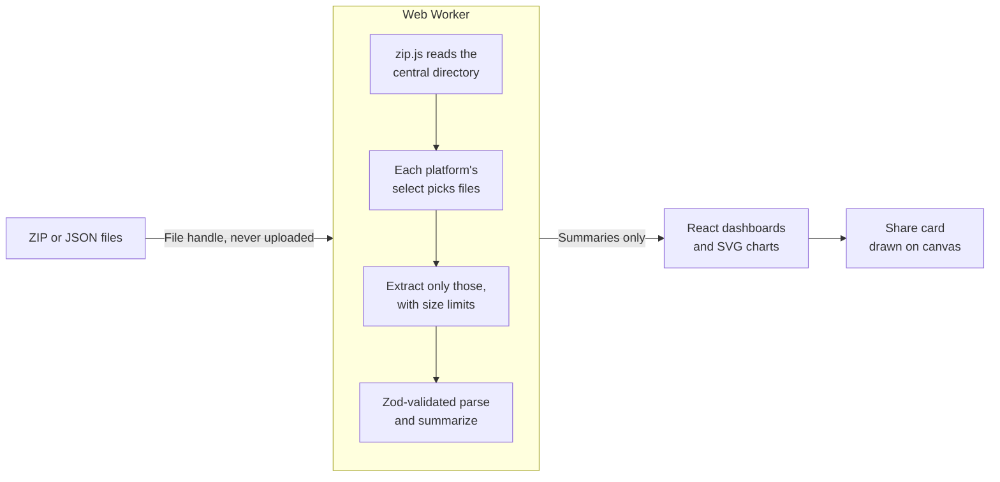

<div align="center">


# Unpacked

**Your data exports, unpacked. Privately.**

Drop the ZIP that Spotify, Instagram or YouTube gives you and get clear charts and lists,<br>
computed entirely in your browser. No account, no upload, no tracking.

[](https://github.com/atuuuuuuu/unpacked/actions/workflows/ci.yml)
[](LICENSE)


[**Live demo**](https://atuuuuuuu.github.io/unpacked/) · [Export guides](#getting-your-data) · [How privacy works](#privacy-you-can-verify) · [Contributing](CONTRIBUTING.md)



</div>

## Why

Every big platform lets you download your data, but what you get is a folder of raw JSON. The tools that read it
usually want something in return: your **password** (Instagram "unfollower" apps, which get accounts locked), a
**subscription** (all-time Spotify stats behind a paywall), or a **server** you have to host.

Unpacked reads the official export in your browser, shows you what's in it, and keeps it on your device. You can check
that claim yourself in about a minute.

## What you get

| Platform      | Highlights                                                                                                                          | What to request                                                                                        | Files Unpacked reads                                                                                      |
| ------------- | ----------------------------------------------------------------------------------------------------------------------------------- | ------------------------------------------------------------------------------------------------------ | --------------------------------------------------------------------------------------------------------- |
| **Spotify**   | Listening time and plays, hours per year and month, top artists and tracks per year, time of day and weekday, skips, podcasts       | [Extended streaming history](https://www.spotify.com/account/privacy/) (Account data also works)       | `Streaming_History_Audio_*.json`, `Streaming_History_Video_*.json`, `StreamingHistory_music_*.json`       |
| **Instagram** | Followers, following, mutuals, who doesn't follow back, fans, pending requests, and **who unfollowed you** by comparing two exports | [Followers and following, JSON format](https://accountscenter.instagram.com/info_and_permissions/dyi/) | `followers_*.json`, `following.json`, `pending_follow_requests.json`, `recently_unfollowed_profiles.json` |
| **YouTube**   | Videos watched, estimated watch time, top channels per year, rewatched videos, viewing patterns, longest sittings and binges        | [Google Takeout: YouTube history, JSON](https://takeout.google.com/)                                   | `watch-history.json`                                                                                      |

Every dashboard has fictional **sample data**, so you can try everything before your export arrives. Each one also
makes a **share card** (a 1080×1350 PNG drawn on your device).

<table>
  <tr>
    <td width="66%"></td>
    <td></td>
  </tr>
  <tr>
    <td></td>
    <td></td>
  </tr>
</table>

## Privacy you can verify

Unpacked is a set of static files. There is no backend, no database, no analytics and no cookies.

- **Reading happens in a Web Worker on your device.** It opens only the files it needs from inside the ZIP (photos are
  never touched), validates every record with [Zod](https://zod.dev), and sends only summaries back to the page.
- **The browser blocks every other destination.** Each page ships a strict Content Security Policy with
  `connect-src 'self'`, so a request to any other site fails before it starts.
- **It works offline.** After one visit, Unpacked is cached by a service worker; turn on airplane mode and it still works.
- **It's tested.** [`e2e/privacy.spec.ts`](e2e/privacy.spec.ts) imports real-shaped exports and fails the build if any
  request goes to another site, uses a method other than GET, or carries a body.
- **Live numbers in the app.** The "On device" badge counts requests to other sites using the browser's own Resource
  Timing API, plus anything the CSP blocked.

Only your theme choice is stored. Summaries are stored only if you turn on **Remember on this device**, and turning it
off deletes them. More detail is on the in-app [privacy page](https://atuuuuuuu.github.io/unpacked/privacy).

## Getting your data

The in-app guides walk through each export step by step:
[Spotify](https://atuuuuuuu.github.io/unpacked/guides/spotify) ·
[Instagram](https://atuuuuuuu.github.io/unpacked/guides/instagram) ·
[YouTube](https://atuuuuuuu.github.io/unpacked/guides/youtube).
The most common mistake is the format: Instagram and YouTube must be exported as **JSON**, not HTML.
Unpacked tells you when it sees an HTML export.

## Run it locally

Requires Node.js 24 or newer (CI runs Node 24).

```sh
git clone https://github.com/atuuuuuuu/unpacked.git
cd unpacked
npm install
npm run dev        # http://localhost:5173
```

| Command         | What it does                                                                  |
| --------------- | ----------------------------------------------------------------------------- |
| `npm run dev`   | Development server with hot reload (no CSP, so hot reload works)              |
| `npm run build` | Type-check and build to `dist/` with the CSP and service worker               |
| `npm test`      | Unit tests for parsers, comparisons and the ZIP pipeline (Vitest)             |
| `npm run e2e`   | End-to-end tests against the production build (Playwright, desktop and phone) |
| `npm run lint`  | Lint and format check (Biome)                                                 |
| `npm run check` | All of the above, in CI order                                                 |

The first `npm run e2e` needs a browser: `npx playwright install chromium`.

## How it works



Platforms are plugins: a parser that runs in the worker (`select`, `diagnose`, `parse`) and a dashboard that runs on
the page. See [docs/architecture.md](docs/architecture.md) for the full picture and
[docs/adding-a-platform.md](docs/adding-a-platform.md) to add one.

| Layer      | Choice                                  | Why                                                                      |
| ---------- | --------------------------------------- | ------------------------------------------------------------------------ |
| App        | Vite, React 19, TypeScript (strict)     | Static app, no server needed                                             |
| UI         | Tailwind CSS v4, Radix primitives       | Accessible menus, dialogs, tabs and selects, styled with our own tokens  |
| Files      | @zip.js/zip.js in a Web Worker, Comlink | Reads single entries from multi-GB ZIPs without loading them into memory |
| Validation | Zod                                     | Exports are untrusted input whose format changes                         |
| Charts     | d3-scale, d3-shape, hand-built SVG      | Full control over the look at a few KB                                   |
| Offline    | vite-plugin-pwa (Workbox)               | Installable; works in airplane mode                                      |
| Quality    | Vitest, Playwright, axe-core, Biome     | Parsers, real browser flows, accessibility, lint                         |

## Deploy

`npm run build` produces a static site in `dist/`. Any static host works.

- **GitHub Pages:** [`.github/workflows/deploy.yml`](.github/workflows/deploy.yml) builds with `BASE_PATH=/unpacked/`
  and publishes on every push to `main` (enable Pages → Source: GitHub Actions).
- **Cloudflare Pages / Netlify:** build command `npm run build`, output `dist`. [`public/_headers`](public/_headers)
  sends the CSP as a real HTTP header and [`public/_redirects`](public/_redirects) handles client-side routes.

## Contributing

New platforms are the most useful contribution, and each one is self-contained. Start with
[CONTRIBUTING.md](CONTRIBUTING.md), then [docs/adding-a-platform.md](docs/adding-a-platform.md). If an export stops
working, the app produces a **format report** that contains key names but no values; paste it into a
[format-changed issue](https://github.com/atuuuuuuu/unpacked/issues/new?template=format-changed.yml).

See the [roadmap](ROADMAP.md) for what's planned.

## License

[MIT](LICENSE). Unpacked is not affiliated with Spotify, Meta or Google. Product names are used only to describe which
exports it reads.
