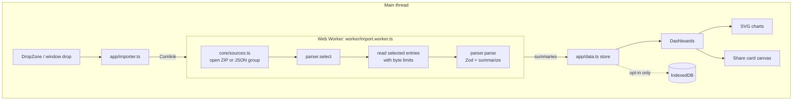

# Architecture

Unpacked is a static, single-page React app. Everything happens in the browser; there is no backend.

## The big picture

## Folders

| Path                       | What lives there                                                                                                                                                                               |
| -------------------------- | ---------------------------------------------------------------------------------------------------------------------------------------------------------------------------------------------- |
| `src/core/`                | Platform-independent pieces: types, errors, ZIP/JSON sources, the import pipeline, time and ranking helpers, the seeded random generator for samples                                           |
| `src/platforms/<id>/`      | One folder per platform: `schema.ts` (Zod), `parse.ts` (select, diagnose, parse, summarize), `types.ts` (the summary shape), `sample.ts` (fictional data in the real file format), `*.test.ts` |
| `src/platforms/parsers.ts` | The worker-side registry of parsers                                                                                                                                                            |
| `src/platforms/ui.tsx`     | Names, icons, pitch and export guide steps for each platform                                                                                                                                   |
| `src/worker/`              | The worker entry point, exposed with Comlink                                                                                                                                                   |
| `src/app/`                 | Main-thread state: data store, importer client, theme, router, network monitor, opt-in persistence                                                                                             |
| `src/components/`          | UI primitives and charts                                                                                                                                                                       |
| `src/features/`            | Import UI, share cards, privacy badge, theme menu                                                                                                                                              |
| `src/pages/`               | Landing, Library, guides, privacy page and the three dashboards                                                                                                                                |
| `e2e/`                     | Playwright tests; `global-setup.ts` builds export ZIPs from the sample generators                                                                                                              |

## Import pipeline

1. **Open.** `openSources` sniffs each dropped file. A file starting with `PK\3\4` is a ZIP; `.json` files are grouped
   into one source, because people often unzip a Spotify export and drop all of its JSON files together. Anything else is
   rejected with a message.
2. **List.** zip.js reads only the ZIP's central directory. Nothing is decompressed yet, so multi-gigabyte Instagram
   exports full of photos open instantly.
3. **Select.** Each parser's `select(paths)` returns the files it needs. The first parser that returns files wins. If none
   does, each parser's `diagnose(paths)` gets a chance to explain (for example "this is an HTML export, choose JSON").
4. **Extract.** Only the selected entries are decompressed, through `CappedTextWriter`, which aborts once an entry passes
   400 MB or the export passes 1 GB in total, whatever the ZIP header claims (zip bomb guard). Encrypted entries are
   refused. Progress is reported by bytes.
5. **Parse.** Every record is validated with Zod. Records that don't match are counted and shown as "left out" rather
   than crashing the import. If nothing matches, the parser throws a `format-changed` error with a **structure report**:
   the JSON's keys and types, never its values, so it can be pasted into an issue safely.
6. **Summarize.** The parser reduces the records to what the dashboard needs (totals, per-year and per-month series,
   top lists, a weekday-by-hour grid). Raw records and fields the dashboards don't use, such as IP addresses, are dropped.
   Only the summary crosses back to the page.

Errors cross the worker boundary as plain values (`{ ok: false, error }`) because Comlink can't carry custom error
classes.

## State

`app/data.ts` holds the list of datasets. Sample and real data never replace each other; each dashboard shows whichever
was added last and offers a switch when both exist. Spotify and YouTube keep one export each; Instagram keeps up to six
so they can be compared. Stores are tiny `useSyncExternalStore` wrappers (`app/createStore.ts`).

Persistence is opt-in. With "Remember on this device" on, real (non-sample) summaries are written to IndexedDB; turning
it off clears the store.

## Privacy controls

- **CSP.** `vite.config.ts` injects a `<meta http-equiv="Content-Security-Policy">` into production builds, and
  `public/_headers` sends the same policy as a header on hosts that support it. `connect-src 'self'` blocks requests to
  other sites, `script-src 'self'` blocks inline and third-party scripts, and assets are never inlined as `data:` URIs
  (`build.assetsInlineLimit: 0`) so `font-src 'self'` holds.
- **Fonts are bundled** with `@fontsource`, not loaded from a CDN.
- **Network monitor.** `app/network.ts` observes Resource Timing entries and `securitypolicyviolation` events and powers
  the "On device" badge and the privacy page numbers.
- **Links** to platforms open only on click, in a new tab, with `rel="noreferrer"`. Sample data never links anywhere.

## Charts

Charts are hand-built SVG with `d3-scale` and `d3-shape`. Each one measures its container with a `ResizeObserver`
(`useWidth`) and redraws instead of scaling, so text stays crisp on phones. Each chart sits in a `<figure>` with a
spoken summary and a screen-reader-only data table.

## Time zones

Exports store UTC timestamps. Bucketing (hour of day, weekday, day, month) uses the device's local time zone, so "your
busiest hour" matches your own clock. Unit tests run with `TZ=UTC`.

## Estimates

YouTube's export has no watch duration. `estimate()` in `platforms/youtube/parse.ts` uses the gap to the next video,
capped at 30 minutes; a longer gap ends the sitting, and the last video of a sitting counts as the median in-sitting
gap. The dashboard labels these numbers as estimates and explains the method.
